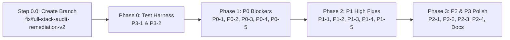

# Homepost (`Rental`) Full-Stack Audit Remediation Plan (v2)

> [!IMPORTANT]
> **Branch & TDD Strategy**: All work will be executed on a dedicated branch (`fix/full-stack-audit-remediation-v2`) with atomic commits per task following **Red-Green-Refactor** (write/update the failing test first, verify it fails, apply the minimal fix, verify all tests pass, then commit).



---

## Step 0.0 — Create Dedicated Git Branch

```powershell
git checkout -b fix/full-stack-audit-remediation-v2
```

---

## Phase 0 — Test Harness & Runner Prerequisites (`P3-1`, `P3-2`)

Fixing the test runners first guarantees every subsequent phase can be verified deterministically with `pytest`, `vitest`, `eslint`, and `tsc`.

### Task 0.1 (`P3-1`): Fix Backend `pytest` Clean-Environment Import Failures
1. **Exact Files & Lines to Modify**:
   - `backend/app/services/storage.py` (lines 31–37)
   - `backend/tests/conftest.py` (lines 1–15)
   - `backend/pytest.ini` (lines 1–4)
2. **Before / After Code Diffs**:
   - In `backend/app/services/storage.py`:
     ```diff
      _s3_client = boto3.client(
          "s3",
     -    endpoint_url=settings.r2_endpoint_url,
     +    endpoint_url=settings.r2_endpoint_url or None,
          aws_access_key_id=settings.r2_access_key_id,
          aws_secret_access_key=settings.r2_secret_access_key,
          region_name="auto",
      )
     ```
   - In `backend/tests/conftest.py`:
     ```diff
     +import os
      import uuid
      from typing import AsyncGenerator
      
     +os.environ.setdefault("DATABASE_URL", "sqlite+aiosqlite:///:memory:")
     +
      import pytest
      from httpx import ASGITransport, AsyncClient
      from sqlalchemy.ext.asyncio import AsyncSession, create_async_engine
      from sqlalchemy.orm import sessionmaker
      from sqlmodel import SQLModel
      
      from app.main import app
     ```
   - In `backend/pytest.ini`:
     ```diff
      [pytest]
      asyncio_mode = auto
      testpaths = tests
     +pythonpath = . tests
      addopts = -p no:cacheprovider
     ```
3. **New / Updated Test Cases**:
   - Add `test_storage_module_imports_with_empty_r2_endpoint()` in `backend/tests/test_uploads.py` verifying `_s3_client` initializes cleanly when `settings.r2_endpoint_url == ""`.
4. **Verification Command & Commit**:
   ```powershell
   .\backend\venv\Scripts\pytest.exe -c backend/pytest.ini backend/tests/test_uploads.py -q
   git add backend/app/services/storage.py backend/tests/conftest.py backend/pytest.ini backend/tests/test_uploads.py
   git commit -m "test(backend): fix clean-env pytest imports and empty R2 endpoint init (P3-1)"
   ```
   - **Expected Output**: All tests in `test_uploads.py` pass (`exit code 0`) without requiring a pre-existing `.env` file.

---

### Task 0.2 (`P3-2a`): Fix Frontend Vitest Worker Timeout on `clerk-mock.test.tsx`
1. **Exact Files & Lines to Modify**:
   - `frontend/vitest.config.ts` (lines 5–19)
2. **Before / After Code Diff**:
   ```diff
    export default defineConfig({
      plugins: [react()],
      test: {
        environment: "jsdom",
   -    pool: "forks",
   -    fileParallelism: false,
   +    pool: "threads",
   +    maxWorkers: 2,
   +    testTimeout: 15000,
   +    hookTimeout: 15000,
        globals: true,
        setupFiles: ["./src/test/setup.ts"],
   ```
3. **Verification Command & Commit**:
   ```powershell
   npm --prefix frontend run test
   git add frontend/vitest.config.ts
   git commit -m "test(frontend): fix vitest worker pool timeout across 24 test suites (P3-2)"
   ```
   - **Expected Output**: `Test Files 24 passed (24)` with `exit code 0`.

---

## Phase 1 — P0 Critical Security & Database Crash Blockers (`P0-1` – `P0-5`)

### Task 1.1 (`P0-1`): Disable Default Demo Mode, Restrict Unsigned `alg: "none"` JWTs to `ALLOWED_DEMO_USER_IDS`, and Fix False-Positive Security Tests
1. **Exact Files & Lines to Modify**:
   - `backend/app/core/config.py` (lines 91–92)
   - `backend/app/core/security.py` (lines 174–190)
   - `render.yaml` (lines 12–16)
   - `frontend/src/lib/demo-mode.ts` (lines 1–10)
   - `backend/tests/test_security_failclosed.py` (lines 30–47)
   - `backend/tests/test_mock_auth_any_sub.py` (lines 1–73)
   - `frontend/src/lib/demo-auth.test.ts` (lines 1–20)
2. **Before / After Code Diffs**:
   - In `backend/app/core/config.py`:
     ```diff
     -    enable_demo_auth: bool = True
     +    enable_demo_auth: bool = False
          environment: str = "development"
     ```
   - In `backend/app/core/security.py`:
     ```diff
          if (
              header.get("alg") == "none"
              and settings.enable_demo_auth
              and settings.environment != "production"
          ):
              payload = jwt.decode(
                  token,
                  options={"verify_signature": False, "verify_exp": True},
                  algorithms=["none"],
              )
     -        if payload.get("sub"):
     +        if payload.get("sub") in ALLOWED_DEMO_USER_IDS:
                  return payload
     ```
   - In `render.yaml`:
     ```diff
          envVars:
            - key: PYTHON_VERSION
              value: 3.11.0
     +      - key: ENVIRONMENT
     +        value: "production"
            - key: ENABLE_DEMO_AUTH
     -        value: "true"
     +        value: "false"
     ```
   - In `frontend/src/lib/demo-mode.ts`:
     ```diff
     -export const IS_DEMO_MODE =
     -  process.env.NEXT_PUBLIC_DEMO_MODE !== "false";
     +export const IS_DEMO_MODE =
     +  process.env.NEXT_PUBLIC_DEMO_MODE === "true";
     ```
3. **New / Updated Test Cases**:
   - In `backend/tests/test_security_failclosed.py`: Remove `monkeypatch.setattr(settings, "enable_demo_auth", False)` from `_reset_security_settings` and add `test_settings_default_enable_demo_auth_is_false()` asserting `Settings(database_url="sqlite+aiosqlite:///:memory:").enable_demo_auth is False`.
   - In `backend/tests/test_mock_auth_any_sub.py`: Update tests so arbitrary `sub` (`user_2abc123xyz`) with `alg: "none"` raises HTTP 401 even when `enable_demo_auth=True`, while `ALLOWED_DEMO_USER_IDS` succeeds when `enable_demo_auth=True` and `environment != "production"`.
   - In `frontend/src/lib/demo-auth.test.ts`: Replace `process.env.NEXT_PUBLIC_DEMO_MODE = "false"` in `beforeEach` with `delete process.env.NEXT_PUBLIC_DEMO_MODE` so the test genuinely verifies the unset default is `false`.
4. **Verification Command & Commit**:
   ```powershell
   .\backend\venv\Scripts\pytest.exe -c backend/pytest.ini backend/tests/test_security_failclosed.py backend/tests/test_mock_auth_any_sub.py backend/tests/test_security_jwt.py -q
   npm --prefix frontend run test -- src/lib/demo-auth.test.ts src/lib/demo-auth-enabled.test.ts
   git add backend/app/core/config.py backend/app/core/security.py render.yaml frontend/src/lib/demo-mode.ts backend/tests/test_security_failclosed.py backend/tests/test_mock_auth_any_sub.py frontend/src/lib/demo-auth.test.ts
   git commit -m "sec(auth): disable default demo mode and restrict alg:none JWTs to allowlist (P0-1)"
   ```
   - **Expected Output**: All backend JWT/fail-closed tests and frontend demo-auth tests pass (`exit code 0`).

---

### Task 1.2 (`P0-2`): Gate `get_current_user` Role Auto-Promotion Behind Non-Production & Allowlist
1. **Exact Files & Lines to Modify**:
   - `backend/app/dependencies/auth.py` (lines 130–139 and 172–193)
2. **Before / After Code Diff**:
   ```diff
   -    if settings.enable_demo_auth and user.role == UserRole.UNASSIGNED:
   +    is_allowed_demo_auto_role = (
   +        settings.enable_demo_auth
   +        and settings.environment != "production"
   +        and clerk_id in ALLOWED_DEMO_USER_IDS
   +    )
   +    if is_allowed_demo_auto_role and user.role == UserRole.UNASSIGNED:
            token_role = payload.get("role")
   ```
   *(Apply the same `is_allowed_demo_auto_role` guard to the new-user branch at lines 172–193).*
3. **New / Updated Test Cases**:
   - Add `test_non_demo_user_jwt_role_claim_ignored_even_when_demo_auth_enabled()` and `test_demo_role_auto_promotion_blocked_in_production()` in `backend/tests/test_security_failclosed.py`.
4. **Verification Command & Commit**:
   ```powershell
   .\backend\venv\Scripts\pytest.exe -c backend/pytest.ini backend/tests/test_security_failclosed.py -q
   git add backend/app/dependencies/auth.py backend/tests/test_security_failclosed.py
   git commit -m "sec(rbac): gate JWT role auto-promotion behind non-prod and demo allowlist (P0-2)"
   ```
   - **Expected Output**: All tests in `test_security_failclosed.py` pass (`exit code 0`).

---

### Task 1.3 (`P0-3`): Make `completeOnboarding` Server Action Fail Closed on Unverified Role
1. **Exact Files & Lines to Modify**:
   - `frontend/src/app/actions/onboarding.ts` (lines 7–46)
2. **Before / After Code Diff**:
   ```diff
   -export async function completeOnboarding(role: "landlord" | "tenant") {
   +export async function completeOnboarding(_requestedRole?: "landlord" | "tenant") {
      const { userId, getToken } = await auth();
      if (!userId) {
        return { error: "No Logged In User" };
      }
    
   -  let verifiedRole: "landlord" | "tenant" = role;
   +  let verifiedRole: "landlord" | "tenant" | null = null;
      try {
        const token = await getToken();
        const apiUrl = process.env.NEXT_PUBLIC_API_URL || "http://localhost:8000";
        const res = await fetch(`${apiUrl}/api/v1/onboarding/me`, {
          headers: token ? { Authorization: `Bearer ${token}` } : {},
          cache: "no-store",
        });
        if (res.ok) {
          const dbUser = await res.json();
          if (dbUser?.role === "landlord" || dbUser?.role === "tenant") {
            verifiedRole = dbUser.role;
          }
        }
      } catch {
   -    // Fall back to requested role if backend check is unreachable in test/dev
   +    return { error: "Unable to verify onboarding role with backend" };
      }
    
   +  if (!verifiedRole) {
   +    return { error: "User role is not verified in database" };
   +  }
   ```
3. **New / Updated Test Cases**:
   - Create `frontend/src/app/actions/onboarding.test.ts` testing:
     1. Rejects when backend returns `role: "unassigned"` or `role: "tenant_pending"` (does not call `updateUserMetadata`).
     2. Rejects when backend fetch throws or returns 500.
     3. Updates Clerk `publicMetadata.role` only when backend returns `"landlord"` or `"tenant"`.
4. **Verification Command & Commit**:
   ```powershell
   npm --prefix frontend run test -- src/app/actions/onboarding.test.ts
   git add frontend/src/app/actions/onboarding.ts frontend/src/app/actions/onboarding.test.ts
   git commit -m "sec(frontend): make completeOnboarding server action fail closed on unverified DB role (P0-3)"
   ```
   - **Expected Output**: `onboarding.test.ts` passes (`exit code 0`).

---

### Task 1.4 (`P0-4` & `P0-5`): Fix `tenant_profiles.unit_id` Nullability & Unit Announcement Cascade Delete + R2 Cleanup
1. **Exact Files & Lines to Modify**:
   - `backend/app/models/tenant_profile.py` (lines 31–34)
   - `backend/app/services/storage_cleanup.py` (lines 35–52)
   - `backend/app/services/properties.py` (lines 121–174)
   - New Alembic migration: `backend/alembic/versions/2026_10_26_0001-b8c42d91e3a0_nullable_tenant_unit_and_announcement_unit_cascade.py`
   - `backend/tests/test_onboarding.py` & `backend/tests/test_seed_and_lifecycle.py`
2. **Before / After Code Diffs**:
   - In `backend/app/models/tenant_profile.py`:
     ```diff
          user_id: uuid.UUID = Field(foreign_key="users.id", unique=True, nullable=False, index=True)
     -    unit_id: uuid.UUID = Field(foreign_key="units.id", nullable=False, index=True)
     +    unit_id: Optional[uuid.UUID] = Field(default=None, foreign_key="units.id", nullable=True, index=True)
     ```
   - In `backend/app/services/storage_cleanup.py`:
     ```diff
          docs = (await session.execute(select(Document).where(Document.unit_id == unit_id))).scalars().all()
          for doc in docs:
              if doc.file_key:
                  keys.append(doc.file_key)
     +
     +    anns = (
     +        await session.execute(select(Announcement).where(Announcement.unit_id == unit_id))
     +    ).scalars().all()
     +    for ann in anns:
     +        keys.extend(ann.attachment_keys or [])
          return keys
     ```
   - In `backend/app/services/properties.py`:
     ```diff
          docs = (await session.execute(select(Document).where(Document.unit_id == unit.id))).scalars().all()
          for d in docs:
              await session.delete(d)
    
     +    anns = (
     +        await session.execute(select(Announcement).where(Announcement.unit_id == unit.id))
     +    ).scalars().all()
     +    for ann in anns:
     +        await session.delete(ann)
     +
          await session.delete(unit)
     ```
   - In new Alembic migration `2026_10_26_0001-b8c42d91e3a0_nullable_tenant_unit_and_announcement_unit_cascade.py` (`down_revision = "c4e91a23f012"`):
     ```python
     def upgrade() -> None:
         op.alter_column("tenant_profiles", "unit_id", existing_type=sa.Uuid(), nullable=True)
         op.drop_constraint("fk_announcements_units", "announcements", type_="foreignkey")
         op.create_foreign_key(
             "fk_announcements_units",
             "announcements",
             "units",
             ["unit_id"],
             ["id"],
             ondelete="CASCADE",
         )
     ```
3. **New / Updated Test Cases**:
   - Add `test_register_tenant_creates_profile_with_null_unit_id()` in `backend/tests/test_onboarding.py`.
   - Add `test_delete_unit_with_unit_announcement_succeeds_and_collects_r2_keys()` in `backend/tests/test_seed_and_lifecycle.py`.
4. **Verification Command & Commit**:
   ```powershell
   .\backend\venv\Scripts\pytest.exe -c backend/pytest.ini backend/tests/test_onboarding.py backend/tests/test_seed_and_lifecycle.py backend/tests/test_index_drift_h11.py -q
   git add backend/app/models/tenant_profile.py backend/app/services/storage_cleanup.py backend/app/services/properties.py backend/alembic/versions/ backend/tests/test_onboarding.py backend/tests/test_seed_and_lifecycle.py
   git commit -m "fix(db): allow nullable tenant_profiles.unit_id and cascade delete unit announcements (P0-4, P0-5)"
   ```
   - **Expected Output**: All onboarding, lifecycle, and schema drift tests pass (`exit code 0`).

---

## Phase 2 — P1 High RBAC, Rate Limiting, Privacy & Search Fixes (`P1-1` – `P1-5`)

### Task 2.1 (`P1-1`): Enforce `require_non_demo_user` on Tenant & Onboarding Routers
1. **Exact Files & Lines to Modify**:
   - `backend/app/routers/tenant.py` (lines 19–48)
   - `backend/app/routers/onboarding.py` (lines 19–48)
   - `backend/tests/test_demo_guard_h7.py`
2. **Before / After Code Diff**:
   - In `backend/app/routers/tenant.py` and `backend/app/routers/onboarding.py`:
     ```diff
     -router = APIRouter()
     +router = APIRouter(dependencies=[Depends(require_non_demo_user)])
     ```
3. **New / Updated Test Cases**:
   - Extend `backend/tests/test_demo_guard_h7.py` with `test_demo_tenant_cannot_create_maintenance_request()` and `test_demo_user_cannot_mutate_onboarding_endpoints()` asserting HTTP 403 (`"Demo accounts cannot modify data"`), while `GET /api/v1/tenant/dashboard` and `GET /api/v1/onboarding/me` return HTTP 200.
4. **Verification Command & Commit**:
   ```powershell
   .\backend\venv\Scripts\pytest.exe -c backend/pytest.ini backend/tests/test_demo_guard_h7.py -q
   git add backend/app/routers/tenant.py backend/app/routers/onboarding.py backend/tests/test_demo_guard_h7.py
   git commit -m "sec(demo): enforce require_non_demo_user on tenant and onboarding routers (P1-1)"
   ```
   - **Expected Output**: All tests in `test_demo_guard_h7.py` pass (`exit code 0`).

---

### Task 2.2 (`P1-2`): Harden Rate Limiter Against `X-Forwarded-For` Spoofing & Add Default Limits
1. **Exact Files & Lines to Modify**:
   - `backend/app/core/limiter.py` (lines 19–35)
   - `backend/tests/test_limiter_h5.py`
2. **Before / After Code Diff**:
   ```diff
    def get_user_or_ip(request: Request) -> str:
        user_id = getattr(request.state, "user_id", None)
        if user_id:
            return f"user:{user_id}"
   -    forwarded = request.headers.get("x-forwarded-for")
   -    if forwarded:
   -        return f"ip:{forwarded.split(',')[0].strip()}"
        return f"ip:{get_remote_address(request)}"
    
   -limiter = Limiter(key_func=get_user_or_ip)
   +limiter = Limiter(key_func=get_user_or_ip, default_limits=["120/minute"])
   ```
3. **New / Updated Test Cases**:
   - Update `backend/tests/test_limiter_h5.py` with `test_spoofed_x_forwarded_for_does_not_bypass_rate_limit()` verifying that sending distinct `X-Forwarded-For` headers from the same client IP still triggers HTTP 429 on the 11th request.
4. **Verification Command & Commit**:
   ```powershell
   .\backend\venv\Scripts\pytest.exe -c backend/pytest.ini backend/tests/test_limiter_h5.py -q
   git add backend/app/core/limiter.py backend/tests/test_limiter_h5.py
   git commit -m "sec(limiter): prevent X-Forwarded-For spoofing and add default rate limit (P1-2)"
   ```
   - **Expected Output**: All tests in `test_limiter_h5.py` pass (`exit code 0`).

---

### Task 2.3 (`P1-3`): Filter `Document.is_archived == False` Across Tenant & Landlord Document Queries
1. **Exact Files & Lines to Modify**:
   - `backend/app/services/tenants.py` (lines 210–216)
   - `backend/app/routers/tenant.py` (lines 415–426)
   - `backend/app/routers/landlord.py` (lines 648–654 & 703–709)
2. **Before / After Code Diffs**:
   - In `backend/app/services/tenants.py`:
     ```diff
              for d in docs:
                  d.is_archived = True
     +            session.add(d)
     ```
   - In `backend/app/routers/tenant.py` and `backend/app/routers/landlord.py`:
     ```diff
              select(Document)
              .where(
                  Document.property_id == unit.property_id,
     +            Document.is_archived == False,  # noqa: E712
                  or_(Document.unit_id == None, Document.unit_id == unit.id),  # noqa: E711
              )
     ```
3. **New / Updated Test Cases**:
   - Add `test_archived_documents_hidden_from_tenant_and_landlord_document_lists()` in `backend/tests/test_seed_and_lifecycle.py`.
4. **Verification Command & Commit**:
   ```powershell
   .\backend\venv\Scripts\pytest.exe -c backend/pytest.ini backend/tests/test_seed_and_lifecycle.py -q
   git add backend/app/services/tenants.py backend/app/routers/tenant.py backend/app/routers/landlord.py backend/tests/test_seed_and_lifecycle.py
   git commit -m "fix(documents): filter out archived unit documents after clear_data invite (P1-3)"
   ```
   - **Expected Output**: All tests in `test_seed_and_lifecycle.py` pass (`exit code 0`).

---

### Task 2.4 (`P1-4`): Schedule R2 Cleanup on Announcement Delete & Add Document Delete Endpoint + UI Action
1. **Exact Files & Lines to Modify**:
   - `backend/app/routers/landlord.py` (lines 589–603 `delete_announcement` and line 718 `delete_document`)
   - `frontend/src/app/landlord/documents/page.tsx`
2. **Before / After Code Diffs**:
   - In `backend/app/routers/landlord.py`:
     ```diff
      @router.delete("/announcements/{announcement_id}", status_code=status.HTTP_204_NO_CONTENT)
      async def delete_announcement(
          announcement_id: uuid.UUID,
     +    background_tasks: BackgroundTasks,
          current_user: User = Depends(require_landlord),
          session: AsyncSession = Depends(get_session),
      ) -> None:
          ...
     +    attachment_keys = list(ann.attachment_keys or [])
          await session.delete(ann)
          await session.commit()
     +    schedule_r2_cleanup(background_tasks, attachment_keys)
     ```
   - Add `DELETE /api/v1/landlord/documents/{document_id}` in `backend/app/routers/landlord.py`:
     ```python
     @router.delete("/documents/{document_id}", status_code=status.HTTP_204_NO_CONTENT)
     async def delete_document(
         document_id: uuid.UUID,
         background_tasks: BackgroundTasks,
         current_user: User = Depends(require_landlord),
         session: AsyncSession = Depends(get_session),
     ) -> None:
         stmt = (
             select(Document)
             .join(Property, Document.property_id == Property.id)
             .where(Document.id == document_id, Property.landlord_id == current_user.id)
         )
         doc = (await session.execute(stmt)).scalar_one_or_none()
         if not doc:
             raise HTTPException(status_code=status.HTTP_404_NOT_FOUND, detail="Document not found")
         file_key = doc.file_key
         await session.delete(doc)
         await session.commit()
         if file_key:
             schedule_r2_cleanup(background_tasks, [file_key])
     ```
   - In `frontend/src/app/landlord/documents/page.tsx`: Add a `Trash2` delete button with `ConfirmDialog` calling `fetchApi(\`/api/v1/landlord/documents/\${docToDelete.id}\`, { method: "DELETE" })` and removing the deleted document from state.
3. **New / Updated Test Cases**:
   - Add `test_delete_announcement_schedules_r2_cleanup()` and `test_delete_document_removes_row_and_schedules_r2_cleanup()` in `backend/tests/test_seed_and_lifecycle.py`.
4. **Verification Command & Commit**:
   ```powershell
   .\backend\venv\Scripts\pytest.exe -c backend/pytest.ini backend/tests/test_seed_and_lifecycle.py -q
   git add backend/app/routers/landlord.py frontend/src/app/landlord/documents/page.tsx backend/tests/test_seed_and_lifecycle.py
   git commit -m "feat(documents): add document delete endpoint/UI and R2 cleanup on announcement delete (P1-4)"
   ```
   - **Expected Output**: All tests in `test_seed_and_lifecycle.py` pass (`exit code 0`).

---

### Task 2.5 (`P1-5`): Fix Broken `debouncedSearchQuery` `useMemo` Dependencies & Resolve All 14 ESLint Warnings
1. **Exact Files & Lines to Modify**:
   - `frontend/src/app/landlord/properties/page.tsx`
   - `frontend/src/app/landlord/units/page.tsx`
   - `frontend/src/app/tenant/documents/page.tsx`
   - `frontend/src/app/landlord/access-requests/page.tsx`
   - `frontend/src/app/tenant/announcements/page.tsx`
   - `frontend/src/app/tenant/dashboard/page.tsx`
   - `frontend/src/components/LightboxModal.tsx`
   - `frontend/src/components/landing/FeatureSection.test.tsx`
   - `frontend/src/components/ui/date-picker.tsx`
   - `frontend/src/lib/clerk-mock.tsx`
2. **Before / After Code Diffs**:
   - In `landlord/properties/page.tsx`, `landlord/units/page.tsx`, and `tenant/documents/page.tsx`:
     ```diff
     -  }, [properties, searchQuery, filterOccupancy]);
     +  }, [properties, debouncedSearchQuery, filterOccupancy]);
     ```
   - Wrap `handleZoomIn`, `handleZoomOut`, `handleResetZoom` in `useCallback` in `LightboxModal.tsx`, wrap `loadData` / `loadAll` in `useCallback` in `access-requests/page.tsx` and `tenant/dashboard/page.tsx`, replace `<a>` with Next `<Link>` in `clerk-mock.tsx`, and remove unused `eslint-disable` in `FeatureSection.test.tsx`.
3. **New / Updated Test Cases**:
   - Add a test in `frontend/src/hooks/useDebouncedValue.test.ts` verifying `useMemo` recomputes after the 150ms debounce timer fires.
4. **Verification Command & Commit**:
   ```powershell
   npm --prefix frontend run lint
   .\frontend\node_modules\.bin\tsc.cmd -p frontend\tsconfig.json --noEmit
   git add frontend/src/
   git commit -m "fix(frontend): fix debouncedSearchQuery useMemo deps and resolve all ESLint warnings (P1-5)"
   ```
   - **Expected Output**: `✔ No ESLint warnings or errors` (`exit code 0`) and `tsc --noEmit` exits with `0`.

---

## Phase 3 — P2 Medium & P3 Polish (`P2-1`, `P2-2`, `P2-3`, `P2-4`, `README.md`)

### Task 3.1 (`P2-1` & `P2-2`): Fix Inverted Tenant Announcement Badge, Parallelize `RequestCard` Uploads & Validate `ReopenModal` Files
1. **Exact Files & Lines to Modify**:
   - `frontend/src/app/tenant/announcements/page.tsx`
   - `frontend/src/components/landlord/requests/RequestCard.tsx`
   - `frontend/src/components/tenant/requests/ReopenModal.tsx`
2. **Before / After Code Diffs**:
   - In `frontend/src/app/tenant/announcements/page.tsx`:
     ```diff
     -const isUnitSpecific = !ann.unit_id;
     +const isUnitSpecific = Boolean(ann.unit_id);
     ```
   - In `frontend/src/components/landlord/requests/RequestCard.tsx`:
     ```diff
     -      const uploadedKeys: string[] = [];
     -      for (const file of files) {
     -        const key = await uploadFile(file, token);
     -        uploadedKeys.push(key);
     -      }
     +      const uploadedKeys = files.length > 0 ? await uploadFiles(files, token) : [];
     ```
   - In `frontend/src/components/tenant/requests/ReopenModal.tsx`: Validate `file.size <= 10 * 1024 * 1024` and allowed MIME/extensions before adding to `files`, displaying a user-facing error message when rejected.
3. **New / Updated Test Cases**:
   - Update `frontend/src/components/tenant/requests/ReopenModal.test.tsx` to assert files >10MB or unsupported extensions are rejected with an inline error.
   - Update `frontend/src/components/landlord/requests/RequestCard.test.tsx` to assert `uploadFiles` is called for multi-file uploads.
4. **Verification Command & Commit**:
   ```powershell
   npm --prefix frontend run test -- src/components/tenant/requests/ReopenModal.test.tsx src/components/landlord/requests/RequestCard.test.tsx
   git add frontend/src/app/tenant/announcements/page.tsx frontend/src/components/landlord/requests/RequestCard.tsx frontend/src/components/tenant/requests/ReopenModal.tsx frontend/src/components/tenant/requests/ReopenModal.test.tsx frontend/src/components/landlord/requests/RequestCard.test.tsx
   git commit -m "fix(ux): fix tenant announcement badge, parallelize uploads, and validate reopen files (P2-1, P2-2)"
   ```

---

### Task 3.2 (`P2-3`): Wire `useFormDraft` & `usePaginatedList` into Frontend Pages and Mount `/api/v1/health` Router
1. **Exact Files & Lines to Modify**:
   - `frontend/src/app/tenant/requests/new/page.tsx` (replace manual `localStorage` draft effects with `useFormDraft`)
   - `frontend/src/app/tenant/documents/page.tsx` & `frontend/src/app/landlord/documents/page.tsx` (wire `usePaginatedList`)
   - `backend/app/main.py` (mount `health.router`)
2. **Before / After Code Diff** (`backend/app/main.py`):
   ```diff
   +from app.routers.health import router as health_router
    from app.routers.landlord import router as landlord_router
    ...
   +app.include_router(health_router, prefix="/api/v1", tags=["Health"])
   ```
3. **New / Updated Test Cases**:
   - Add `test_api_v1_health_returns_healthy_with_db_check()` in `backend/tests/test_seed_and_lifecycle.py`.
4. **Verification Command & Commit**:
   ```powershell
   .\backend\venv\Scripts\pytest.exe -c backend/pytest.ini backend/tests/test_seed_and_lifecycle.py -q
   npm --prefix frontend run test
   git add backend/app/main.py backend/tests/test_seed_and_lifecycle.py frontend/src/app/tenant/requests/new/page.tsx frontend/src/app/tenant/documents/page.tsx frontend/src/app/landlord/documents/page.tsx
   git commit -m "refactor(fullstack): wire useFormDraft, usePaginatedList, and mount /api/v1/health router (P2-3)"
   ```

---

### Task 3.3 (`P2-4` & `P3-2b`): Deduplicate `render.yaml` Entrypoint & Align `README.md` Stack Versions
1. **Exact Files & Lines to Modify**:
   - `backend/docker-entrypoint.sh`
   - `render.yaml`
   - `README.md`
2. **Before / After Code Diffs**:
   - In `backend/docker-entrypoint.sh`:
     ```diff
      echo "Starting FastAPI server..."
     -exec uvicorn app.main:app --host 0.0.0.0 --port 8000 --proxy-headers --forwarded-allow-ips="*"
     +exec uvicorn app.main:app --host 0.0.0.0 --port "${PORT:-8000}" --proxy-headers --forwarded-allow-ips="*"
     ```
   - In `render.yaml`:
     ```diff
          plan: free
     -    startCommand: sh -c "alembic upgrade head && python seed.py && uvicorn app.main:app --host 0.0.0.0 --port $PORT"
          healthCheckPath: /healthz
     ```
   - In `README.md`:
     ```diff
     -
     +
     ...
     -| **Framework** | Next.js 16 (App Router), React 19 |
     -| **Styling** | Tailwind CSS v4, Shadcn UI, Lucide Icons |
     +| **Framework** | Next.js 16 (App Router), React 18.3 |
     +| **Styling** | Tailwind CSS v3.4, Shadcn UI, Lucide Icons |
     ```
3. **Final Full-Stack Verification Suite & Commit**:
   ```powershell
   .\backend\venv\Scripts\pytest.exe -c backend/pytest.ini backend/tests -q
   npm --prefix frontend run lint
   .\frontend\node_modules\.bin\tsc.cmd -p frontend\tsconfig.json --noEmit
   npm --prefix frontend run test
   git add backend/docker-entrypoint.sh render.yaml README.md
   git commit -m "chore(deploy,docs): deduplicate render entrypoint and align README stack versions (P2-4, P3-2)"
   ```
   - **Expected Output**:
     - Backend `pytest`: **100% passed (`exit code 0`)**
     - Frontend `eslint`: **0 errors, 0 warnings (`exit code 0`)**
     - Frontend `tsc --noEmit`: **0 errors (`exit code 0`)**
     - Frontend `vitest`: **24 of 24 test files passed (`exit code 0`)**
